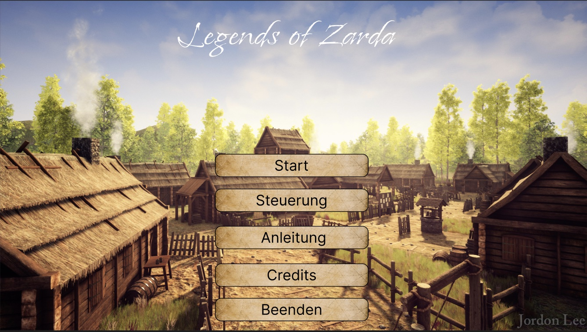
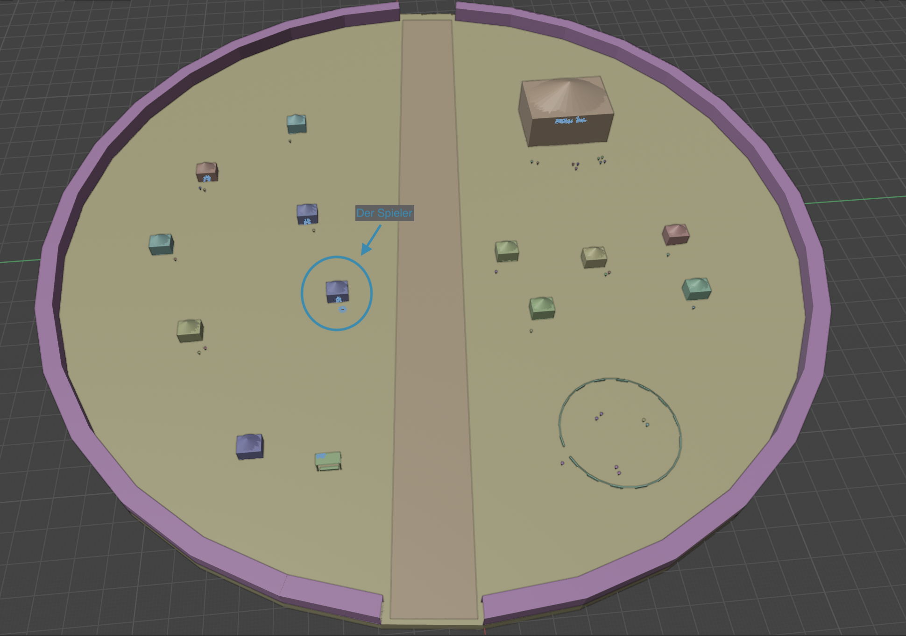

# Legends of Zarda

A 3D fantasy role-playing game built with Unity 6 by a team of five students at
TH Mannheim (winter semester 2025/26).

The player wakes up in a small room, finds a rusty sword and steps out into a fortified
village. There they meet characters like Bertram, the greedy blacksmith, and Gregory, the
quiet guard at the training arena, and follows quests through dialogues with choices.


*Main menu (background artwork by Jordon Lee)*

## Features

- Two connected scenes, the player's room and the village, with transitions between them
- Quest system with steps, flags and branches, defined as ScriptableObjects
- Dialogue system with choices and conditional dialogue that depends on quest progress
- E-key interaction with objects and NPCs, limited by the player's current world state
- Inventory and gold, with custom UI for menus, dialogue and inventory
- Time of day (morning to night) that changes the sky, and a camera manager that switches
  between third-person and top-down views

## Team and roles

| Role | Responsibilities |
|---|---|
| 3D game designer | Game design document, level blockouts, style guide, mockups |
| 3D modeller | Hard-surface modelling |
| 3D material artist | Shaders and textures |
| Level builder | Scene organisation, terrain, lighting, VFX, builds |
| **Unity developer (Noah Richardt)** | **Gameplay code and prefabs with logic, input, dialogue and interaction system, menus and HUD** |

The full workflow between the roles is described in
[`docs/roles-and-processes.md`](docs/roles-and-processes.md) (German).

## Design process

Each scene was planned as a level blockout first, to map out the player's path before the
final 3D assets were built.



## Development process

- Feature branches and pull requests on `main`
- [Conventional commit messages](docs/git-conventions.md) and branch names, enforced with Husky hooks
- C# formatting checked in CI with `dotnet format` ([`format.yml`](.github/workflows/format.yml))
- Game design and level blockouts documented in [`docs/gamedesign/`](docs/gamedesign/), including the
  [game design document](docs/gamedesign/GDD.pdf) (German)

## Project structure

```
unity/             Unity project (Assets, ProjectSettings, Packages)
docs/gamedesign/   Game design document, blockouts, reference images
UI/                Source images for menus, dialogue and inventory
build/             Windows builds
tools/formatting/  Project used by dotnet format
scripts/           Git hook scripts for branch and commit message checks
```

## Running the game

- **Windows:** open `build/build_2026-01-29/` and start `Legends of Zarda.exe`
- **Editor:** open the `unity/` folder in Unity 6 (6000.3.1f1)
